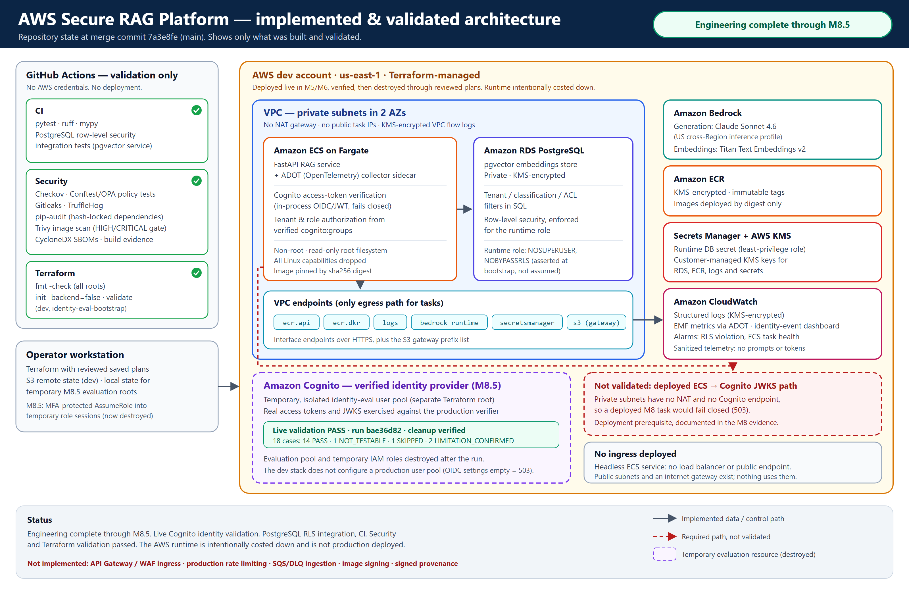
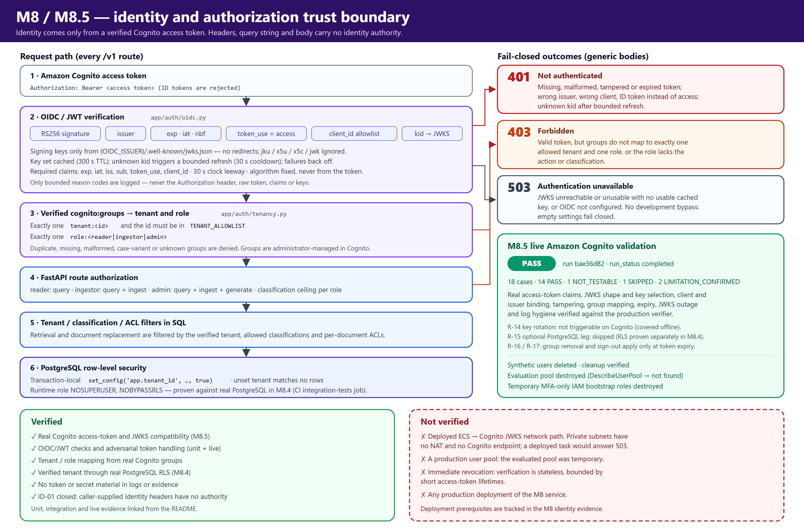
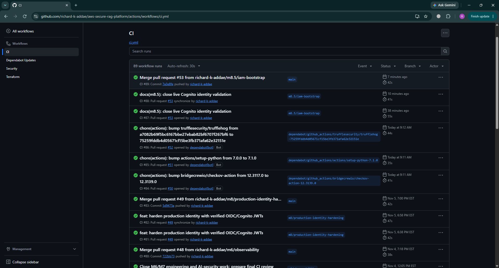
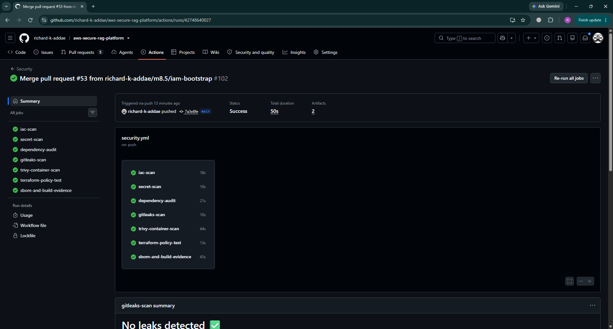
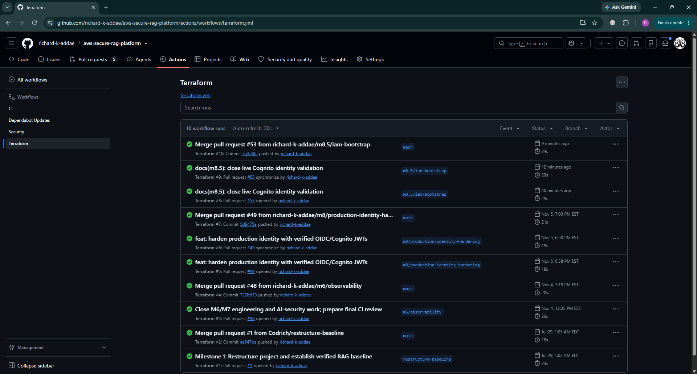
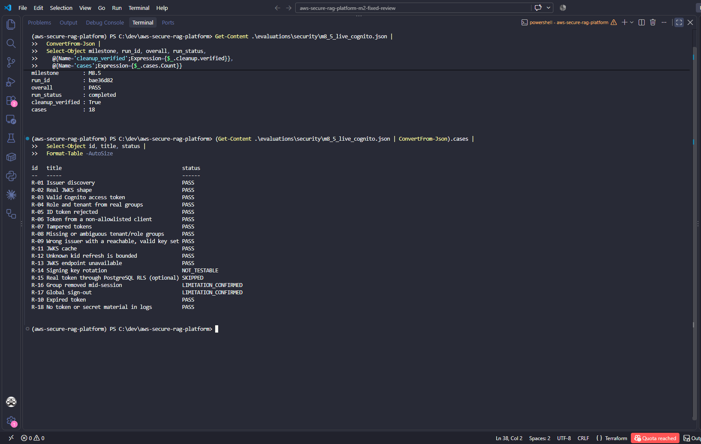

# AWS Secure RAG Platform

> A security-first, multi-tenant Retrieval-Augmented Generation service on Amazon Bedrock. Every answer is scoped by a verified Amazon Cognito identity and enforced down to PostgreSQL row-level security. Built with FastAPI, ECS Fargate, pgvector and Terraform, behind automated DevSecOps gates.

**Engineering complete; not production deployed.** The AWS runtime is intentionally costed down.

- **Verified identity end to end:** replaced caller-supplied tenant headers with verified Amazon Cognito access tokens, enforced tenant and role authorization, and validated the design against real PostgreSQL row-level security and live Cognito.
- **AI security measured, not assumed:** a 21-case adversarial corpus gates CI, and live Amazon Bedrock testing informed an evidence-based decision not to adopt Guardrails.
- **Governed supply chain:** hash-locked dependencies, SBOM generation, automated security gates, and zero unexcepted HIGH/CRITICAL container findings, with temporary exceptions time-boxed and documented.



## What the platform does

A caller asks a question; the service answers **only from documents that caller's tenant and role are allowed to read**, cites the passages it used, and fails closed when it cannot.

- **Verified identity.** Every `/v1` request needs a Cognito access token. Tenant and role come only from administrator-managed `cognito:groups`; headers, query strings and request bodies carry no identity authority.
- **Authorization at retrieval time.** Tenant, classification and per-document ACL filters in SQL, enforced again by PostgreSQL row-level security under a role that cannot bypass it.
- **Untrusted content handled structurally.** Retrieved passages and the question are framed with per-request random boundaries; answers must cite passages that were actually supplied, and sensitive output is withheld or redacted.
- **Measured, not assumed.** A deterministic adversarial corpus gates CI; live Bedrock runs measured model behavior with and without Bedrock Guardrails.

All data is synthetic. This is a platform-engineering and AI-security project, not a chatbot demo.

## Key engineering outcomes

- **Live identity validation with verified cleanup:** a temporary, isolated Cognito pool was created through reviewed Terraform plans by MFA-protected, least-privilege temporary roles, exercised by an 18-case harness, and destroyed, with independent proof that nothing remained.
- **Defense in depth for multi-tenancy:** route authorization, SQL filters and row-level security each enforce the verified tenant; the runtime database role is asserted `NOSUPERUSER NOBYPASSRLS`, not assumed.
- **Pre-registered live model evaluation:** cases and classification rules for the live Bedrock baseline and the Guardrails comparison were frozen before the first call, so the documented *do not adopt* decision rests on criteria set in advance.
- **Fix before suppress:** digest-pinned images and dated, exact-ID scanner exceptions. Fixable CVEs are fixed, not suppressed.

## Identity and authorization

M8 closed finding ID-01: caller-supplied `X-Tenant-*` headers no longer carry identity. Tenant and role now come only from a verified Cognito access token, proven against real PostgreSQL RLS (M8.4) and live Cognito (M8.5).



```text
Cognito access token
  -> OIDC/JWT verification: RS256 signature, issuer, exp/iat, token_use=access,
     client_id allowlist, kid -> issuer-derived JWKS (cached, bounded refresh)
  -> verified cognito:groups: exactly one tenant:<id> (in TENANT_ALLOWLIST)
     and exactly one role:<reader|ingestor|admin>
  -> FastAPI route authorization
  -> tenant / classification / ACL filters in SQL
  -> PostgreSQL row-level security
```

Every failure is fail-closed with a generic body:

- **401:** missing, malformed, tampered or expired tokens; wrong issuer, client or token type.
- **403:** a valid token whose groups don't map to exactly one allowed tenant and one role, or that lacks the action.
- **503:** the signing keys are unavailable with no usable cache, or authentication is not configured.

There is no development bypass, and tokens, claims and keys are never logged.

| Verified | Not verified |
|---|---|
| OIDC/JWT validation code and adversarial token handling | Deployed ECS → Cognito JWKS network path |
| Live Cognito access-token and JWKS compatibility (M8.5) | A production user pool (the evaluated pool was temporary) |
| Tenant/role mapping from real Cognito groups | Immediate revocation (stateless verification, bounded by token lifetime) |
| Verified tenant through real PostgreSQL RLS (M8.4) | Any production deployment of the M8 service |

## Security engineering highlights

- **Identity:**
  - Fixed RS256; signing keys only from the issuer-derived JWKS (no redirects; `jku`/`x5u`/`x5c`/`jwk` ignored).
  - Bounded key refresh with failure backoff.
  - Exactly one tenant group and one role group, or 403.
- **Authorization:**
  - SQL filters plus PostgreSQL RLS.
  - Document replacement is authorized against the *existing* stored classification and ACL, atomically (AUTHZ-01).
- **Prompt boundaries:** per-request CSPRNG boundary tokens, untrusted-context framing, Unicode/control-character sanitization.
- **Output integrity:**
  - Citations are validated against the supplied passages; invalid or uncited answers fail closed.
  - Sensitive output is withheld or redacted.
- **Guardrails:** Bedrock Guardrails were evaluated against a live baseline and **not adopted** on the evidence ([ADR 0005](docs/adr/0005-do-not-adopt-bedrock-guardrails.md)).
- **Infrastructure:**
  - Private subnets with VPC endpoints and no NAT.
  - KMS customer-managed keys and Secrets Manager.
  - Non-root, read-only containers with all capabilities dropped.
  - Least-privilege task roles.
- **Observability:**
  - OpenTelemetry with sanitized telemetry, an ADOT sidecar and CloudWatch metrics.
  - A dashboard of identity security events, plus alarms.

## Final validation evidence

Milestones M1–M8.5 are complete. The M8.5 closure was merged in PR #53 (`7a3e8fe`).

| Evidence | Result |
|---|---|
| Unit and API tests (CI `python-checks`) | Green at M8.5 closure (`7a3e8fe`); 736 passed locally, with the 58 PostgreSQL tests running in their own job |
| PostgreSQL RLS integration (CI `integration-tests`, M8.4) | Green at M8.5 closure (`7a3e8fe`): verified tokens reach real row-level security; invalid tokens and unmappable identities never reach the database |
| Adversarial corpus | 21/21 cases enforced |
| Security workflow | iac-scan, secret-scan, dependency-audit, gitleaks-scan, trivy-container-scan, terraform-policy-test, sbom-and-build-evidence: all green at M8.5 closure (`7a3e8fe`) |
| Terraform workflow | `fmt -check` on all roots; `validate` on `dev` and `identity-eval-bootstrap` |
| Live Cognito validation (M8.5) | PASS, run `bae36d82`, cleanup verified ([JSON evidence](evaluations/security/m8_5_live_cognito.json)) |

### CI, Security and Terraform at M8.5 closure

These are the `main` runs for the PR #53 merge (`7a3e8fe`), the validated M8.5 closure state. They are not necessarily the results for the current tip of `main`, which has since received dependency-maintenance updates and the networking availability-zone pinning fix.







### M8.5 live Cognito validation



Run `bae36d82`: `overall` PASS, `run_status` completed, `cleanup.verified` true. Of the 18 cases:

- **14 PASS:** discovery, real JWKS, valid token, groups → tenant/role, ID-token rejection, wrong client, tampering, ambiguous groups, wrong issuer, expiry, cache, unknown `kid`, JWKS outage, log hygiene.
- **R-14 NOT_TESTABLE:** key rotation can't be triggered on a Cognito pool; it's covered offline.
- **R-15 SKIPPED:** the optional live-token-through-PostgreSQL leg was not run. Real RLS integration is proven separately in M8.4.
- **R-16 and R-17 LIMITATION_CONFIRMED:** group removal and global sign-out take effect only when the access token expires.

All 10 synthetic users were deleted and the deletions verified. The evaluation pool was destroyed (`DescribeUserPool` returns not found), and the temporary IAM bootstrap roles were destroyed.

## Implemented AWS architecture

Built with Terraform and deployed live in M5/M6, then verified and destroyed through reviewed saved plans. The runtime is intentionally costed down. The preserved pre-M8 images must not be redeployed.

| Layer | Implementation |
|---|---|
| Network | VPC with private subnets in two AZs; no NAT; KMS-encrypted flow logs; interface endpoints `ecr.api`, `ecr.dkr`, `logs`, `bedrock-runtime`, `secretsmanager`, plus an S3 gateway |
| Compute | ECS Fargate service (FastAPI + ADOT collector sidecar), private, no public IP, digest-pinned image, non-root, read-only root filesystem |
| Model | Amazon Bedrock: Claude Sonnet 4.6 via a US cross-Region inference profile; Titan Text Embeddings v2 |
| Data | RDS PostgreSQL + pgvector, private and encrypted, with row-level security and a non-bypassing runtime role |
| Secrets and keys | Secrets Manager for the runtime database secret; customer-managed KMS keys for RDS, ECR and logs |
| Registry | Amazon ECR: KMS-encrypted, immutable tags |
| Observability | CloudWatch logs, EMF metrics, dashboard and alarms; local OpenTelemetry Collector, Prometheus and Grafana |
| Identity | In-process Cognito access-token verification; live-validated against a temporary M8.5 pool. The `dev` stack ships with OIDC settings empty, so protected routes fail closed (503) |
| Ingress | None deployed: a headless service with no load balancer |

The vector store is pgvector rather than OpenSearch Serverless. pgvector gives filtered vector search, private connectivity, encryption and backups without OpenSearch Serverless's always-on cost floor ([decision](docs/architecture/VECTOR_STORE_DECISION.md)).

## DevSecOps and supply-chain controls

- **Policy and IaC:**
  - Checkov.
  - Conftest/OPA tests against compliant and non-compliant plan fixtures.
  - Terraform `fmt`/`validate` in CI.
  - Reviewed saved plans for every apply.
- **Secrets:** Gitleaks and TruffleHog.
- **Dependencies:** `uv.lock` hash-locked; pip-audit with `--require-hashes`.
- **Container:**
  - Digest-pinned official base image.
  - The Trivy HIGH/CRITICAL gate includes unfixed findings. Result: **0 unexcepted HIGH/CRITICAL** findings.
- **Exceptions:**
  - Every exception is an exact CVE ID with a reachability statement and an expiry date ([`.trivyignore.yaml`](.trivyignore.yaml): 11 entries, reviewed 2026-11-10 and renewed to 2027-02-04).
  - When Debian ships a fix, it is installed rather than suppressed. CVE-2026-85091 and CVE-2026-76844 are fixed by pinning the Debian security build of `zlib1g`, and the stale CVE-2026-76844 exception was removed.
  - CVE-2026-119373, CVE-2026-119374 and CVE-2026-119379 (SQLite) are excepted: no fixed Debian 13 package exists, and reachability is assessed as low, not impossible.
- **Provenance evidence:** CycloneDX SBOMs, build digests and metadata as CI artifacts.
- **Not delivered:** container image signing and signed provenance.

## Evidence

| Area | Evidence |
|---|---|
| Verified identity (M8, M8.5) | [M8 identity evidence](docs/security/M8_IDENTITY_EVIDENCE.md) · [M8.5 live result (JSON)](evaluations/security/m8_5_live_cognito.json) · [identity-eval root](infrastructure/environments/identity-eval/README.md) · [IAM bootstrap root](infrastructure/environments/identity-eval-bootstrap/README.md) |
| AI security (M7) | [M7 evidence index](docs/security/M7_AI_SECURITY_EVIDENCE_INDEX.md) |
| Live model evaluation | [M7.5 live adversarial baseline](docs/security/M7_5_LIVE_ADVERSARIAL_BASELINE.md) · [M7.6 Guardrails comparison](docs/security/M7_6_GUARDRAILS_COMPARISON.md) |
| Observability (M6) | [M6 evidence](docs/observability/M6_OBSERVABILITY_EVIDENCE.md) · [M6 evidence index](docs/observability/M6_EVIDENCE_INDEX.md) |
| Supply chain (M4) | [Milestone 4 evidence](docs/security/MILESTONE_4_EVIDENCE.md) · [patched ADOT build](docs/security/M6_4_ADOT_PATCHED_BUILD_EVIDENCE.md) |
| Controls and findings | [Control traceability](docs/security/CONTROL_TRACEABILITY.md) · [Failure modes](docs/security/FAILURE_MODES.md) · [Findings](docs/security/FINDINGS.md) |
| Governance | [Threat model](docs/governance/THREAT_MODEL.md) · [NIST AI RMF](docs/governance/NIST_AI_RMF_MAPPING.md) · [OWASP LLM Top 10 (2025, pinned for M7; 2026 remap planned)](docs/governance/OWASP_LLM_TOP_10_MAPPING.md) · [MITRE ATLAS](docs/governance/MITRE_ATLAS_MAPPING.md) |
| Operations | [Deployment runbook](docs/runbooks/DEPLOYMENT_RUNBOOK.md) · [AI incident response](docs/runbooks/AI_INCIDENT_RESPONSE_RUNBOOK.md) · [ADRs](docs/adr/) · [Security policy](SECURITY.md) |

The M7 evidence documents are a historical snapshot. Their counts (for example the number of scanner exceptions at that time) intentionally differ from the current state. Governance mappings are alignment exercises, not certifications.

Historical Milestone 1 screenshots: [CI checks](docs/images/milestone-1-ci-checks.png) · [offline evaluation gate](docs/images/offline-evaluation-gate.png).

## Quickstart (local development)

### Fast checks (no AWS or Cognito needed)

Requires Python 3.11 with [uv](https://docs.astral.sh/uv/).

```bash
uv sync --extra dev   # local Python environment
make lint             # ruff + mypy
make test             # pytest (PostgreSQL RLS tests skip unless TEST_ADMIN_DATABASE_URL and TEST_DATABASE_URL are set)
make evals            # offline evaluation scorecard, including the adversarial corpus
```

Without a Cognito pool, the test suite exercises the identity behavior with synthetic tokens signed by keys generated at test time (`app/tests/identity.py`).

### Full local stack

Builds on the environment above. Also requires Docker and AWS credentials with access to the configured Bedrock generation and embedding models.

```bash
cp .env.example .env   # set BEDROCK_MODEL_ID, EMBEDDING_MODEL_ID and AWS_REGION
make dev               # api + postgres/pgvector via docker compose
make db-init           # extension, table, indexes, RLS policy, runtime role
make ingest            # embed and load the synthetic corpus
curl localhost:8000/healthz
```

**Calling the API requires a verified identity; there is no development bypass.** Every `/v1` route needs `Authorization: Bearer <access token>` from an Amazon Cognito user pool you control:

- Set `OIDC_ISSUER` (`https://cognito-idp.<region>.amazonaws.com/<user-pool-id>`) and `OIDC_CLIENT_IDS` (your app client ID) in `.env`, and keep `TENANT_ALLOWLIST` consistent with your groups.
- Put each test user in exactly one `tenant:<id>` group (matching `TENANT_ALLOWLIST`) and exactly one `role:reader`, `role:ingestor` or `role:admin` group.
- Use the user's **access token**; ID tokens are rejected. The API container needs outbound HTTPS to Cognito to fetch signing keys.

```bash
curl -X POST localhost:8000/v1/query \
  -H "Authorization: Bearer $ACCESS_TOKEN" \
  -H 'Content-Type: application/json' \
  -d '{"question": "What is the document retention period?"}'
```

Expected failure responses:
- **503** `Authentication unavailable`, when OIDC settings are unset.
- **401**, without a valid token.
- **403**, when the groups don't map to exactly one allowed tenant and one role.

Never paste real tokens into issues, logs or commits.

Optional local observability:

```bash
docker compose -f docker-compose.yml -f docker-compose.observability.yml up --build   # optional local observability
```

## Repository structure

```
app/              FastAPI service: routes, RAG core, clients, auth (OIDC verification, tenancy), telemetry, tests
infrastructure/   Terraform modules and roots:
                    environments/dev                      the platform stack
                    environments/identity-eval            temporary M8.5 Cognito evaluation pool (destroyed)
                    environments/identity-eval-bootstrap  temporary M8.5 MFA-only IAM roles (destroyed)
evaluations/      Golden dataset, adversarial cases, offline tests, live M7.5/M7.6/M8.5 harnesses and evidence
policy/           Conftest/OPA Terraform policies and fixtures (CI gate)
policies/         Additional policy-as-code and IAM baselines
observability/    Collector, Prometheus, Grafana, dashboard and alarm definitions
tools/            Patched ADOT collector build
docs/             Architecture, governance, security evidence, runbooks, ADRs, images
scripts/          DB init, ingestion, evaluation runners, live Cognito validation and its Terraform wrapper
synthetic-data/   Synthetic document corpus (no real data)
```

## Milestones

| Milestone | Outcome |
|---|---|
| M1 | Cited RAG flow, packaging, lint/type/test baseline |
| M2 | Tenant-aware retrieval, classification, authorization and misuse-case tests (identity was a header resolver until M8) |
| M3 | Golden dataset and deterministic offline evaluation gates in CI |
| M4 | IaC, secret, dependency and container scanning; policy-as-code; SBOMs and build evidence (no image signing) |
| M5 | Terraform AWS delivery: private ECS/RDS deployed live, verified, then torn down |
| M6 | OpenTelemetry, ADOT, CloudWatch metrics, dashboard and alarms; local Prometheus/Grafana |
| M7 | AI security: adversarial corpus, AUTHZ-01 fix, prompt-boundary and output hardening, live Bedrock baseline, Guardrails evaluation |
| M8 | Verified Cognito access tokens replace caller-supplied identity (ID-01); proven against real PostgreSQL RLS (M8.4) |
| M8.5 | Live Cognito validation: PASS (run `bae36d82`); temporary pool and IAM roles destroyed |

## Deployment readiness and residual risks

**Engineering complete does not mean production ready.** The project is not production deployed, and no AWS runtime is running. Before any network-exposed deployment, these remain open ([M8 prerequisites](docs/security/M8_IDENTITY_EVIDENCE.md#deployment-prerequisites-open), [M7 deployment gate](docs/security/M7_AI_SECURITY_EVIDENCE_INDEX.md#deployment-gate)):

- **JWKS network path:**
  - ECS tasks run in private subnets with no NAT and no Cognito endpoint.
  - The deployed ECS-to-Cognito JWKS path has **not** been validated; a deployed M8 task would fail closed (503).
- **New image required:** the preserved pre-M8 deployment images trust caller headers. They are not deployable M8 artifacts.
- **Production identity provider and OIDC configuration:**
  - No production user pool exists.
  - `oidc_issuer` and `oidc_client_ids` default to empty (fail closed); Terraform only warns.
- **S2 sensitive-output gap:** the output detector misses one synthetic internal-key family. Request input and `/v1/generate` output aren't checked, and there is no per-identity rate limiting.
- **Operator identity:**
  - Terraform still runs as a long-lived IAM user in the AWS Organizations management account.
  - M8.5 itself used MFA-protected temporary roles, now destroyed.
- **Supply chain:**
  - No image signing or signed provenance.
  - The 11 scanner exceptions must be reviewed again by 2027-02-04.
  - The runtime image installs the exact Debian security build of `zlib1g` until the official base image includes it.
- **Stateless tokens:** revocation and group removal take effect only at access-token expiry; keep lifetimes short.
- **Alarm notification and secret rotation not implemented:** alarms are state-only (no approved SNS destination), and runtime database secret rotation is not automated. These are production-hardening items, recorded as five Checkov risk-acceptance exceptions (four CKV_AWS_319, one CKV2_AWS_57) due for review by 2027-02-04 ([runbook](docs/runbooks/DEPLOYMENT_RUNBOOK.md#infrastructure-cleanup-and-checkov-skips)).

## Future production architecture — not implemented

The following would be required for production and were **not** built:

- Managed ingress (API Gateway or an ALB with TLS) with AWS WAF.
- Per-identity rate limiting and quotas.
- Queue-based ingestion (SQS with a dead-letter queue).
- A validated network path from ECS to the identity provider's JWKS.
- A production identity provider.
- Container image signing and signed provenance; CI deployment through OIDC.
- Operator access through short-lived role credentials in a dedicated member account.

## What this project demonstrates

- **Cloud engineering:** VPC design with endpoints, ECS Fargate, RDS, IAM, KMS, Secrets Manager, ECR, all in Terraform.
- **Identity and access:** OIDC/JWT verification, group-based multi-tenancy, PostgreSQL RLS, least-privilege temporary roles for live testing.
- **DevSecOps:** GitHub Actions gates, policy-as-code, supply-chain scanning, governed exceptions, reviewed plans.
- **AI engineering:** RAG on Bedrock, embeddings, pgvector search, grounded and cited answers.
- **AI security:**
  - prompt-injection defenses, authorization boundaries and output controls
  - adversarial and live evaluation
  - evidence-based Guardrails decisions
- **Engineering honesty:** every claim is tied to evidence, and residual risks stay visible.

## License

MIT
